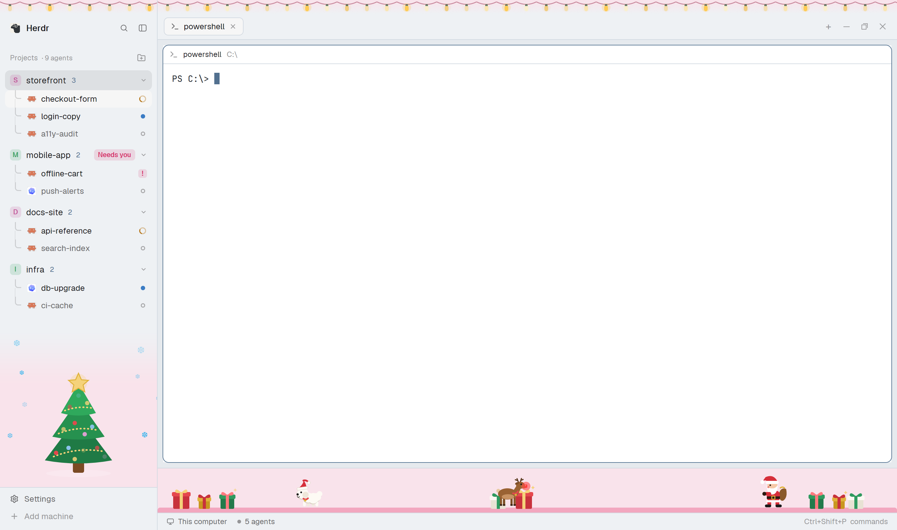

# herdr-christmas

A light Christmas layout for [Herdr](https://herdr.dev): glowing bulbs across the top, a twinkling tree in the sidebar, and a parade of a bichon in a Santa hat, Rudolph and Santa along the bottom. The sidebar lists agents by project folder.



## Install

1. Copy `layouts/christmas.json` to `~/.config/herdr-app/layouts/`.
2. Copy `themes/christmas.json` to `~/.config/herdr-app/themes/`.
3. Copy each folder in `mods/` to `~/.config/herdr-app/mods/` (`xmas-lights`, `xmas-tree`, `xmas-parade`, `project-tree`).
4. Check the mods and switch:

   ```sh
   herdr-app check ~/.config/herdr-app/mods/xmas-parade
   herdr-app do layout.switch --name christmas
   ```

`ctrl-shift-l` switches back to your own layout. Deleting the files removes it.

See [RECIPE.md](RECIPE.md) for the full brief.
