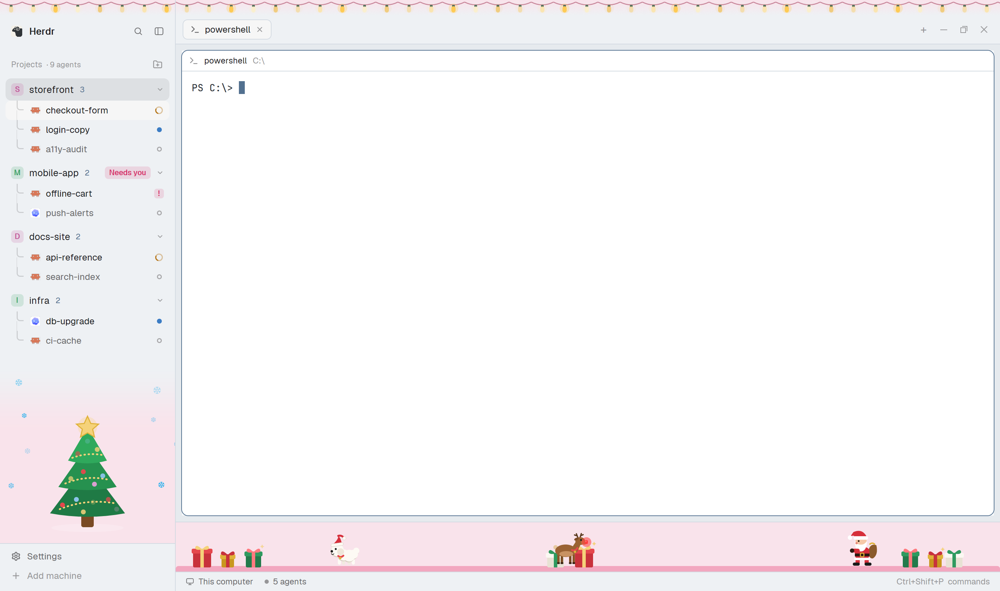

# Herdr Christmas

A soft, light Christmas window: a string of glowing bulbs across the top, a
twinkling tree in a pink corner of the sidebar, and a parade along the bottom
where a bichon in a Santa hat, Rudolph and Santa hop back and forth between
piles of presents. The terminals stay plain white; the chrome is a calm
gray-blue. The sidebar lists agents by project folder as a tree.

## What you see

Left to right: a 268px sidebar, then the work column.

**Sidebar** (`chrome` #eef1f4), top to bottom:

- **Lights** (22px): a wire of 32px scallops (`wire.svg`, 14px tall) with one
  bulb at each low point. The block background is a vertical gradient from
  pink `#f9e3eb` at the top to the chrome gray `#eef1f4`.
- **Brand** (46px): the shipped `workspace-chrome` header.
- **Projects** (fills the rest, min 120px): the `project-tree` mod. Each
  project folder is a header (letter tile, name, tab count, "Needs you" when
  an agent is blocked) with its tabs under it on tree lines, each with its
  agent icon, title and status.
- **Tree** (260px): pink `#f9e3eb`. The top 104px fades from `#eef1f4` into the
  pink (smoothstep, 2px strips). A 140x170 tree (`tree.svg`) sits 15px above
  the bottom edge, centered, with a glow behind its star, 13 twinkling
  ornaments, and 8 pink (`#e79ab3`) snowflakes swaying 6px side to side.
- **Footer** (69px): the shipped `workspace-chrome` footer (Settings, Add
  machine).

**Work column**, top to bottom:

- **Lights** (22px), same as the sidebar's, starting 4 bulbs later
  (`props.offset: 4`) so the colors don't line up at the seam.
- **Tabs** (42px): the shipped `tabs` mod.
- **Panes** (8px padding and gap): white cards, 10px radius, 1px `border`,
  1px `accent` when focused, a 30px `pane` header on top. A Files/Changes
  panel (368px) is on the right, hidden by default.
- **Parade** (72px): light pink `#f9e3eb`, 1px top `border`, a 9px ground
  strip `#f2a7bf` with 4px rounded top. Eight gift boxes (`gift-red`,
  `gift-gold`, `gift-green`, `gift-white`, 22 to 30px wide) at fixed shares of
  the width (left pile, middle, right pile), every other one with a gold `✦`
  fading in and out.
- **Status** (28px): the shipped `workspace-status` bar.

**Theme** `christmas`: terminal background `#ffffff`, text `#2b3138`,
selection `#d3dbe4`, cursor and accent `#52708f`, canvas `#e6eaee`, chrome
`#eef1f4`, border `#d3dae2`, and a rose/green/gold ANSI palette.

## How it behaves

- **Bulbs:** five warm yellows. Each bulb's glass (opacity 0.5 to 1) and halo
  (0.05 to 0.3) breathe together on a period of 2600 to 4400ms, which differs
  bulb to bulb.
- **Tree:** the star glow pulses every 1.8s; ornaments twinkle from 0.25 to 1
  on periods of 1.1 to 2.3s; the snowflakes sway left and right and fade.
- **Parade:** three walkers (Rudolph 56x48, Santa 48x56, the bichon 48x48 with
  a hat layer) walk from wall to wall at 45px/s, all on one shared span
  (8px in from each edge, minus the widest sprite). They start a third of a
  round trip apart, so they pass each other head-on but never overlap
  walking the same way, even after hours or a resize. Each turns to face its
  direction (`-l0` / `-r0` sprites) and hops 3px every 440ms. There are no
  leg frames. Rudolph's nose has a red halo that glows every 1.6s.
- **Projects:** a working agent shows a spinner, a blocked one a `!` and a
  "Needs you" pill on its project, done a dot, idle a ring. Click a row to
  focus that agent; click a project to fold it (remembered); hover a project
  and press `+` for a new Claude in that folder; the folder icon at the top
  adds a project from the folder picker. Spaces with the same folder merge.

## Built from

- `layouts/christmas.json`, cloned from the shipped `main` (0.1.16), root
  `"theme": "christmas"`, `"titlebar": "none"`, background `canvas`,
  terminal padding `[14, 12]`. Tree: root row → `sidebar` column
  (`xmas-lights-side`, `brand`, `projects`, `xmas-tree`, `sidebar-footer`) and
  `work` column (`xmas-lights-top`, `tabs`, `work-body` row with `main` tab
  block and the hidden `panel` stack, `xmas-parade`, `status`). The lights
  blocks and `tabs`/`brand` have `window_drag: true`.
- `themes/christmas.json`.
- Mods, all `"place": "none"`:
  - `xmas-lights`: `props.offset` shifts the bulb colors. No background of
    its own; the block's gradient shows through.
  - `xmas-tree`: `tree.svg` plus native `loop` animations.
  - `xmas-parade`: sprites `deer-{l,r}0.svg`, `santa-{l,r}0.svg`,
    `dog-{l,r}0.svg`, hat layers `dog-hat-{l,r}.svg`, `gift-*.svg`.
  - `project-tree`: `spaces()`, `agents()`, `home()`, `pickFolder()`,
    `setAgentOrder()`; commands `pane.focus`, `space.select`, `tab.select`,
    `tab.new`, `space.new`.
- Shipped mods used as-is: `workspace-chrome`, `tabs`, `pane`, `files`,
  `changes`, `workspace-status`.

## Watch out

- `div().bg()` takes a solid color only, so the tree's fade is 52 stacked 2px
  strips; a gradient belongs on the layout block's `background`.
- `.loop()` animates only opacity, width, height, left and top. Walking uses
  `.transition("left", { duration, easing: "linear" })` to the next wall,
  with `cx.timer.after` to turn around.
- Positions come from the clock (`t0` + phase), not from where the last leg
  ended. A span per sprite width makes the walkers drift together within
  minutes.
- The hat is its own static image layer over the dog. Putting it in frames
  that swap made it flicker.
- On the first size change, place the walkers and start them one frame
  (60ms) later, or the first transition doesn't show.
- Block `colors`/`background` don't recolor shipped mods that paint
  `theme().chrome` themselves; clone them if you need that.
- The pinks and grays are written as hex for this light theme; on a dark
  theme the decorations stay light.

## Done when

- Bulbs glow along the whole top of both columns, and their colors don't
  repeat at the sidebar/work seam.
- The tree area is pink, fading from the sidebar gray at its top, and the
  tree is pinned to its bottom.
- The bichon (with hat), Rudolph and Santa each walk back and forth on their
  own at the same speed, hop, turn at the walls, and never walk stacked on
  top of each other, including after resizing the window.
- Two spaces in the same folder show as one project in the sidebar.
- `herdr-app check` passes for each folder in `mods/`.
